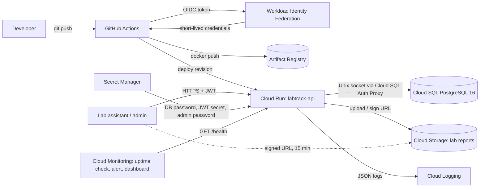

# LabTrack: Cloud-Native Practicum Management API on Google Cloud Platform

LabTrack is a REST API for running university lab practicums: student records, course enrollment, practicum sessions, attendance with an at-risk recap, and PDF lab report submission with grading. It runs serverless on Cloud Run, stores data in Cloud SQL for PostgreSQL and report files in a private Cloud Storage bucket. All infrastructure is defined in Terraform and deployed through GitHub Actions without service account keys.

## Architecture



| Layer | Service | Notes |
|---|---|---|
| Compute | Cloud Run (v2) | Scale 0 to 3, 512 MiB, startup and liveness probes on `/health` |
| Database | Cloud SQL PostgreSQL 16, db-f1-micro | No authorized networks, TLS only, daily backups kept 7 days |
| Object storage | Cloud Storage | Uniform access, public access prevention, versioning, V4 signed URLs |
| Secrets | Secret Manager | Injected as env vars, never stored in the image or repo |
| Identity | Dedicated runtime and deployer service accounts | Least privilege roles only |
| CI/CD | GitHub Actions + Workload Identity Federation | Test, build, push, deploy, smoke test |
| IaC | Terraform (google provider 6.x) | Whole stack in `infra/terraform` |
| Observability | Cloud Logging, uptime check, alert policy, dashboard | Structured JSON logs with request ID |

## API overview

Interactive docs are served at `/docs` (Swagger UI) and `/redoc`.

| Method | Path | Role | Purpose |
|---|---|---|---|
| POST | `/auth/login` | public | Get a JWT (OAuth2 password flow) |
| GET | `/auth/me` | any | Current user |
| POST, GET | `/auth/users` | admin | Create and list staff accounts |
| GET, POST | `/students` | any | Search (NIM or name, paginated) and create |
| GET, PATCH, DELETE | `/students/{id}` | any, delete is admin | Read, update, delete |
| POST, GET | `/courses` | create is admin | Practicum courses |
| POST | `/courses/{id}/enrollments` | any | Enroll students (idempotent) |
| GET | `/courses/{id}/students` | any | Enrolled students |
| GET | `/courses/{id}/attendance-summary?threshold=75` | any | Per-student attendance rate and at-risk flag |
| POST, GET | `/sessions` | create is admin | Practicum sessions (modules) |
| PUT, GET | `/sessions/{id}/attendance` | any | Bulk upsert and list attendance |
| POST, GET | `/sessions/{id}/reports` | any | Upload a PDF report (multipart) and list |
| GET | `/reports/{id}/download-url` | any | 15 minute signed download URL |
| PATCH | `/reports/{id}/grade` | any | Score 0 to 100 with feedback |
| GET | `/health` | public | Liveness and database check |

Design decisions worth noting:

- **Attendance rate** = (present + late) / sessions held. A session counts as held once any attendance is recorded, and a missing record in a held session counts as absent.
- **Uploads** are checked by file signature (`%PDF-`), not by the client's content type, and capped at 10 MB.
- **Login** compares against a dummy bcrypt hash when the email is unknown, so response time does not reveal registered emails.
- **Signed URLs** on Cloud Run go through the IAM signBlob API because the runtime credentials carry no private key. The runtime service account is granted Token Creator on itself for this.

## Run locally

```bash
python -m venv .venv && source .venv/bin/activate
pip install -r requirements.txt -r requirements-dev.txt
cp .env.example .env
uvicorn app.main:app --reload --port 8080
# open http://localhost:8080/docs, log in as admin@labtrack.dev / AdminPass123
```

Without `DATABASE_URL` the app uses SQLite and stores uploads in `./uploads`. To mirror production with PostgreSQL:

```bash
docker compose up --build
BASE_URL=http://localhost:8080 ADMIN_PASSWORD=AdminPass123 python scripts/seed_demo.py
```

## Tests

```bash
pytest -q --cov=app --cov-report=term-missing
```

19 tests cover auth and role checks, validation, conflict handling, idempotent enrollment and attendance upserts, the attendance summary math, PDF upload validation, signed download, and grading. Coverage is about 93%.

## Deploy to Google Cloud

Step by step guide (Indonesian): [docs/PANDUAN-DEPLOYMENT.md](docs/PANDUAN-DEPLOYMENT.md)

Short version:

```bash
cd infra/terraform && cp terraform.tfvars.example terraform.tfvars   # fill in
terraform init
terraform apply -target=google_project_service.apis -target=google_artifact_registry_repository.repo
gcloud builds submit --tag asia-southeast2-docker.pkg.dev/PROJECT_ID/labtrack/api:v1 ../..
terraform apply
terraform output github_vars   # copy into GitHub repository variables
```

## Project structure

```
app/
  main.py            FastAPI app, lifespan, access log middleware, /health
  config.py          Settings from environment (Cloud SQL socket, GCS, JWT)
  database.py        SQLAlchemy engine and session
  models.py          ORM models
  schemas.py         Pydantic request and response models
  security.py        bcrypt and JWT
  deps.py            Auth dependencies and helpers
  storage.py         GCS and local storage backends
  logging_config.py  JSON logs for Cloud Logging
  routers/           auth, students, courses, sessions, reports
infra/terraform/     main.tf, cicd.tf, monitoring.tf, variables.tf, outputs.tf
.github/workflows/   ci-cd.yml
scripts/seed_demo.py Demo data through the public API
tests/               pytest suite
```

## Known limitations

- Tables are created at startup with `create_all`. Schema changes after go-live should move to Alembic migrations.
- Cloud SQL uses public IP restricted to the Auth Proxy. A private IP with a Serverless VPC connector or Direct VPC egress is the stricter option at extra cost.
- Deleting a student removes database rows but leaves old PDFs in the bucket.
