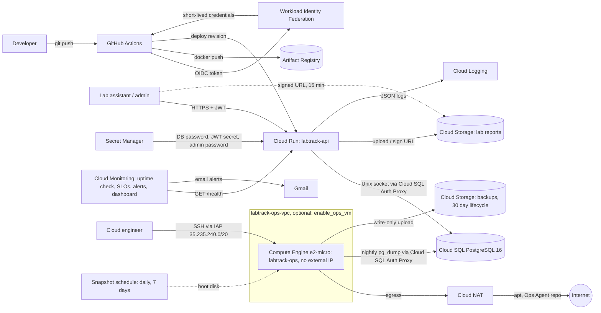

# LabTrack: Cloud-Native Practicum Management API on Google Cloud Platform

LabTrack is a REST API for running university lab practicums: student records, course enrollment, practicum sessions, attendance with an at-risk recap, and PDF lab report submission with grading. It runs serverless on Cloud Run, stores data in Cloud SQL for PostgreSQL and report files in a private Cloud Storage bucket. All infrastructure is defined in Terraform and deployed through GitHub Actions without service account keys.

## Architecture



| Layer | Service | Notes |
|---|---|---|
| Compute | Cloud Run (v2) | Scale 0 to 3, 512 MiB, startup and liveness probes on `/health` |
| Database | Cloud SQL PostgreSQL 16, db-f1-micro | No authorized networks, TLS only, daily backups kept 7 days |
| Object storage | Cloud Storage | Uniform access, public access prevention, versioning, V4 signed URLs |
| Secrets | Secret Manager | Injected as env vars, never stored in the image or repo |
| Identity | Dedicated runtime and deployer service accounts | Least privilege roles only |
| CI/CD | GitHub Actions + Workload Identity Federation | Shellcheck, test, Terraform validate, build, push, deploy, smoke test |
| IaC | Terraform (google provider 6.x) | Whole stack in `infra/terraform` |
| Observability | Cloud Logging, uptime check, SLOs, alert policies, dashboard | Structured JSON logs; every error body carries the same `request_id` as the log line |
| SLOs | Cloud Monitoring service monitoring | 99.5% non-5xx requests and 95% under 800 ms over 30 days, fast-burn alert (`slo.tf`) |
| Ops VM (optional, off by default) | Compute Engine e2-micro, Cloud NAT, IAP | Nightly `pg_dump` to a write-only bucket, daily disk snapshots (`iaas.tf`) |

## Live deployment

| | |
|---|---|
| Web app (lab staff) | https://labtrack-api-b26757zszq-et.a.run.app/app/ |
| API (Swagger UI) | https://labtrack-api-b26757zszq-et.a.run.app/docs |
| Health | https://labtrack-api-b26757zszq-et.a.run.app/health |
| Google Cloud project | `labtrack-1026146` (Cloud Run and Cloud SQL in `asia-southeast2`, ops VM in `us-central1`) |
| CI/CD | [GitHub Actions](https://github.com/Muhammadabrarrayhan2/labtrack/actions) |
| Evidence | [docs/00-PEMETAAN-UNIT-KOMPETENSI.md](docs/00-PEMETAAN-UNIT-KOMPETENSI.md), screenshots in [docs/bukti/screenshots](docs/bukti/screenshots) |
| Word documents | [docs/word](docs/word): Laporan Proyek, Artikel Jurnal, Manual Pengguna, Dokumentasi Teknis (.docx and .pdf) |

Measured on Google Cloud on 26 October 2026: 50 users for 5 minutes gave 7,049 requests with no failures and a p95 of 69 ms; the stepped stress test saturated between 150 and 200 users at the 3-instance cap; a Cloud SQL restore test passed in about 27 minutes; a simulated database outage recovered in about 20 minutes.

## Web app

Lab staff use the web front end at `/app/`; browsers that open `/` are redirected there, while API clients still get JSON. It is plain HTML, CSS and JavaScript in `app/static/`, served by the same Cloud Run service, so it adds no infrastructure or cost. Views: attendance summary with an at-risk threshold, bulk attendance entry, student search and enrollment, report upload, download and grading, and an admin view for courses, sessions and staff accounts. Every error message shows the `request_id` so a report can be matched to its log line.

`scripts/evidence/screenshot_webapp.py` seeds example data (course `CC-CONTOH`) through the API and drives the UI in headless Edge; its screenshots are `docs/bukti/screenshots/web-*.png`.

## API overview

Interactive docs are served at `/docs` (Swagger UI) and `/redoc`.

| Method | Path | Role | Purpose |
|---|---|---|---|
| POST | `/auth/login` | public | Get a JWT (OAuth2 password flow) |
| GET | `/auth/me` | any | Current user |
| POST, GET | `/auth/users` | admin | Create and list staff accounts |
| GET, POST | `/students` | any | Search (NIM or name, paginated) and create |
| GET, PATCH, DELETE | `/students/{id}` | any, delete is admin | Read, update, delete |
| POST, GET | `/courses` | create is admin | Practicum courses |
| POST | `/courses/{id}/enrollments` | any | Enroll students (idempotent) |
| GET | `/courses/{id}/students` | any | Enrolled students |
| GET | `/courses/{id}/attendance-summary?threshold=75` | any | Per-student attendance rate and at-risk flag |
| POST, GET | `/sessions` | create is admin | Practicum sessions (modules) |
| PUT, GET | `/sessions/{id}/attendance` | any | Bulk upsert and list attendance |
| POST, GET | `/sessions/{id}/reports` | any | Upload a PDF report (multipart) and list |
| GET | `/reports/{id}/download-url` | any | 15 minute signed download URL |
| PATCH | `/reports/{id}/grade` | any | Score 0 to 100 with feedback |
| GET | `/health` | public | Liveness and database check |

Design decisions worth noting:

- **Attendance rate** = (present + late) / sessions held. A session counts as held once any attendance is recorded, and a missing record in a held session counts as absent.
- **Uploads** are checked by file signature (`%PDF-`), not by the client's content type, and capped at 10 MB.
- **Login** compares against a dummy bcrypt hash when the email is unknown, so response time does not reveal registered emails.
- **Signed URLs** on Cloud Run go through the IAM signBlob API because the runtime credentials carry no private key. The runtime service account is granted Token Creator on itself for this.

## Run locally

```bash
python -m venv .venv && source .venv/bin/activate
pip install -r requirements.txt -r requirements-dev.txt
cp .env.example .env
uvicorn app.main:app --reload --port 8080
# open http://localhost:8080/docs, log in as admin@labtrack.dev / AdminPass123
```

Without `DATABASE_URL` the app uses SQLite and stores uploads in `./uploads`. To mirror production with PostgreSQL:

```bash
docker compose up --build
BASE_URL=http://localhost:8080 ADMIN_PASSWORD=AdminPass123 python scripts/seed_demo.py
```

## Tests

```bash
pytest -q --cov=app --cov-report=term-missing
```

68 tests: the original 19 API tests, 3 JWT clock-skew tests, 11 tests that every error response carries a `request_id` matching the `X-Request-ID` header and the log line, 3 end-to-end integration check tests, 17 tests for the SLA report math (request-based and uptime-based availability) on mocked Cloud Monitoring time series, 3 tests for the stress profile, and 12 tests for the ops scripts with fake `gcloud`, `psql` and `cloud-sql-proxy` binaries. Coverage of `app/` is about 94%. Set `TEST_DATABASE_URL` to run the API tests against PostgreSQL; CI does this with a PostgreSQL 16 service container (job `test-postgres`). CI also runs `shellcheck` and `terraform fmt -check` / `validate`.

## Load test

`scripts/loadtest/locustfile.py` simulates lab assistants at the start of a practicum session. Each virtual user logs in once, then calls `GET /students`, `GET /courses/{id}/attendance-summary`, `PUT /sessions/{id}/attendance` and `GET /health` with a 1 to 3 second think time. Seed the target first with `scripts/seed_demo.py`.

```bash
pip install -r requirements-dev.txt
export API=$(terraform -chdir=infra/terraform output -raw api_url)
export LABTRACK_PASSWORD=$(gcloud secrets versions access latest --secret=labtrack-admin-password)
mkdir -p docs/bukti/003
locust -f scripts/loadtest/locustfile.py --host "$API" \
  --headless -u 50 -r 5 -t 5m \
  --csv docs/bukti/003/locust --html docs/bukti/003/locust-report.html
```

50 users, spawn rate 5 per second, 5 minutes. `COURSE_ID` and `SESSION_ID` (default 1) select the seeded course and session. Results go into `docs/03-kebutuhan-perangkat-keras.md` section 5.

## Deploy to Google Cloud

Step by step guide (Indonesian): [docs/PANDUAN-DEPLOYMENT.md](docs/PANDUAN-DEPLOYMENT.md)

Short version:

```bash
cd infra/terraform && cp terraform.tfvars.example terraform.tfvars   # fill in
terraform init
terraform apply -target=google_project_service.apis -target=google_artifact_registry_repository.repo
gcloud builds submit --tag asia-southeast2-docker.pkg.dev/PROJECT_ID/labtrack/api:v1 ../..
terraform apply
terraform output github_vars   # copy into GitHub repository variables
```

Optional components, both off by default because they add monthly cost (estimates are in the variable descriptions in `variables.tf`):

- `enable_sla_alerts = true` creates the five SLA alert policies in `slo.tf`. The SLOs and dashboard are always created.
- `enable_ops_vm = true` creates the IaaS ops VM in `iaas.tf`.

## Operations

Routine scripts live in `scripts/ops/`. Each reads `PROJECT_ID` and `REGION` from the environment, uses `set -euo pipefail`, and prints every command before running it.

| Script | Layer | Purpose |
|---|---|---|
| `deploy-image.sh` | PaaS | Deploy an image tag as a new Cloud Run revision, with smoke test |
| `rollback.sh` | PaaS | Shift 100% of traffic to the previous revision, `--to-latest` to undo |
| `scale.sh` | PaaS | Set min/max instances, warns when the Cloud SQL connection budget is exceeded |
| `rotate-secret.sh` | PaaS | New JWT secret version and a forced new revision |
| `sql-start-stop.sh` | PaaS | Start, stop or show the Cloud SQL instance |
| `sql-backup-now.sh` | PaaS | On-demand Cloud SQL backup |
| `sql-restore-test.sh` | PaaS | Restore the latest backup into a temporary instance, compare row counts, write a restore verification report, delete it |
| `vm-start-stop.sh` | IaaS | Start, stop or show the ops VM |
| `vm-ssh.sh` | IaaS | SSH through IAP, optionally run one command |
| `vm-snapshot-now.sh` | IaaS | Manual boot disk snapshot |
| `vm-patch.sh` | IaaS | `apt` upgrade over IAP, optional snapshot first and reboot; appends to a change log |
| `vm-report.sh` | IaaS | VM provisioning report: config, CPU, memory, disk, network, gateway, NAT egress, services |

`scripts/sla_report.py` writes the monthly SLA report to `docs/laporan-sla/YYYY-MM.md` from Cloud Monitoring data, with request-based availability, p95 latency and, given `--uptime-check-id`, time-based availability from the uptime check.

`scripts/api_integration_check.py` runs a 9-step end-to-end check (health, login, create, read back, update, 409, 401, delete, 404) against any running instance and writes a Markdown report.

For a stress test, set `LOAD_SHAPE=stress`: 100, 150, 200, 250 and 300 users for two minutes each, then 20 users to watch recovery (`scripts/loadtest/stages.py`).

## Project structure

```
app/
  main.py            FastAPI app, lifespan, access log middleware, error handlers with request_id, /health
  config.py          Settings from environment (Cloud SQL socket, GCS, JWT)
  database.py        SQLAlchemy engine and session
  models.py          ORM models
  schemas.py         Pydantic request and response models
  security.py        bcrypt and JWT
  deps.py            Auth dependencies and helpers
  storage.py         GCS and local storage backends
  logging_config.py  JSON logs for Cloud Logging
  routers/           auth, students, courses, sessions, reports
infra/terraform/
  main.tf            APIs, Artifact Registry, IAM, secrets, Cloud SQL, bucket, Cloud Run
  cicd.tf            Workload Identity Federation and deployer service account
  monitoring.tf      Uptime check, uptime alert, dashboard
  slo.tf             Custom service, availability and latency SLOs, SLA alert policies
  iaas.tf            Optional ops VM, VPC, Cloud NAT, IAP firewall, backup bucket, snapshot schedule
  templates/         Startup script for the ops VM
  variables.tf, outputs.tf, versions.tf, .terraform.lock.hcl
.github/
  workflows/         ci-cd.yml
  ISSUE_TEMPLATE/    User problem report and incident report forms (Indonesian)
scripts/
  seed_demo.py       Demo data through the public API
  loadtest/          Locust scenario
  ops/               Routine operations scripts (PaaS and IaaS)
  sla_report.py      Monthly SLA report from Cloud Monitoring
  api_integration_check.py  End-to-end check against a running API
docs/                Certification portfolio in Indonesian, see below
  bukti/             Evidence folders per competency unit, with screenshot checklists
  bukti/lokal/       Real outputs from the local docker compose stack (integration, load, restore, incident)
  laporan-sla/       Generated monthly SLA reports
tests/               pytest suite
```

## Kesesuaian dengan skema sertifikasi

Repositori ini disusun sebagai bukti kompetensi (APL02) untuk sertifikasi BNSP Cloud Computing Engineer berdasarkan SKKNI Kepmenaker Nomor 456 Tahun 2015. Asesor sebaiknya mulai dari [docs/00-PEMETAAN-UNIT-KOMPETENSI.md](docs/00-PEMETAAN-UNIT-KOMPETENSI.md), yang memetakan setiap elemen kompetensi ke berkas, skrip, resource Terraform, test, dan kode tangkapan layar.

| Unit | Dokumen |
|---|---|
| J.631120.001.01 Mendefinisikan terminologi dan konsep cloud computing | [01-konsep-cloud-computing.md](docs/01-konsep-cloud-computing.md) |
| J.631120.002.01 Mengidentifikasi teknologi cloud computing | [02-teknologi-cloud.md](docs/02-teknologi-cloud.md) |
| J.631120.003.01 Mengidentifikasi berbagai jenis perangkat keras yang dibutuhkan | [03-kebutuhan-perangkat-keras.md](docs/03-kebutuhan-perangkat-keras.md) |
| J.631120.013.01 Menjalankan aktivitas rutin pada IaaS, PaaS, dan SaaS | [04-aktivitas-rutin-iaas-paas-saas.md](docs/04-aktivitas-rutin-iaas-paas-saas.md) |
| J.631120.014.01 Memantau sarana dan prasarana sesuai SLA | [05-sla-dan-pemantauan.md](docs/05-sla-dan-pemantauan.md) |
| J.631120.015.01 Memberikan dukungan teknis dan report next layer | [06-sop-dukungan-teknis.md](docs/06-sop-dukungan-teknis.md) |
| Pemetaan ke modul pelatihan (40 slide, lab 1 sampai 4, bukti minimum) | [07-kesesuaian-modul-pelatihan.md](docs/07-kesesuaian-modul-pelatihan.md) |

Langkah deploy dan pengambilan bukti: [docs/PANDUAN-DEPLOYMENT.md](docs/PANDUAN-DEPLOYMENT.md). Bukti nyata dari lingkungan lokal (uji integrasi 9/9 lulus, uji beban 2.953 permintaan tanpa galat, *backup-restore-verify* 7/7 tabel identik, simulasi insiden pulih sekitar 39 detik) ada di [docs/bukti/lokal/](docs/bukti/lokal/).

## Documents

The Word deliverables in `docs/word/` are generated from the Markdown sources in `docs/word/src/`:

```bash
python scripts/docs/build_word.py            # needs python-docx and Pillow
python scripts/docs/word_finalize.py docs/word/*.docx   # Windows + Word: refresh the table of contents, export PDF
```

## Known limitations

- Tables are created at startup with `create_all`. Schema changes after go-live should move to Alembic migrations.
- Cloud SQL uses public IP restricted to the Auth Proxy. A private IP with a Serverless VPC connector or Direct VPC egress is the stricter option at extra cost.
- Deleting a student removes database rows but leaves old PDFs in the bucket.
- There is no API endpoint to deactivate a user or reset a password; the runbook does it in Cloud SQL Studio (`docs/04-aktivitas-rutin-iaas-paas-saas.md`).
- Startup and liveness probes call `/health`, which checks the database. While Cloud SQL is down, new instances fail the startup probe, so some users get Cloud Run's own 503 page without a `request_id`.
- The connection budget (3 instances x 7 = 21 of 25) is tight; two revisions running side by side during a rollout can exceed it briefly.
