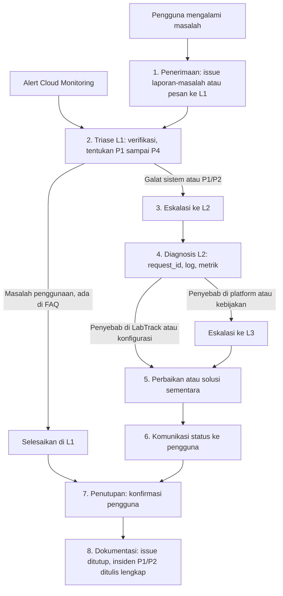

# SOP Dukungan Teknis dan Eskalasi LabTrack

Unit kompetensi: **J.631120.015.01 Memberikan dukungan teknis atas masalah user dan report next layer**

Dokumen ini adalah prosedur operasi standar (SOP) untuk menangani masalah pengguna LabTrack, mulai dari penerimaan laporan sampai penutupan, termasuk tingkat keparahan, matriks eskalasi ke lapis berikutnya, panduan pemecahan masalah, contoh laporan insiden, dan templat komunikasi.

## 1. Sarana pendukung

| Sarana | Fungsi | Lokasi |
|---|---|---|
| `request_id` pada setiap respons galat | Menghubungkan laporan pengguna dengan baris log yang tepat | Kolom `request_id` di badan JSON dan header `X-Request-ID` (`app/main.py`) |
| Templat laporan masalah | Formulir terstruktur bagi pengguna | `.github/ISSUE_TEMPLATE/laporan-masalah.yml` |
| Templat laporan insiden | Catatan penanganan insiden oleh L2 | `.github/ISSUE_TEMPLATE/laporan-insiden.yml` |
| Log terstruktur | `severity`, `request_id`, `method`, `path`, `status`, `latency_ms` | Cloud Logging, `app/logging_config.py` |
| Alert dan SLO | Deteksi gangguan sebelum dilaporkan | `infra/terraform/monitoring.tf`, `infra/terraform/slo.tf` |
| Skrip operasional | Tindakan pemulihan yang teruji | `scripts/ops/` |

Contoh respons galat yang diterima pengguna:

```json
{"detail": "Invalid or expired token", "request_id": "7f3c2a9d1b4e8f60"}
```

Kueri Logs Explorer untuk menemukan permintaan tersebut:

```
resource.type="cloud_run_revision"
resource.labels.service_name="labtrack-api"
jsonPayload.request_id="7f3c2a9d1b4e8f60"
```

Pada Cloud Run, `request_id` diambil dari header `X-Cloud-Trace-Context`, sehingga nilai yang sama juga dapat dipakai untuk membuka *trace* permintaan.

## 2. Alur dukungan



| Tahap | Pelaksana | Kegiatan | Keluaran | Batas waktu |
|---|---|---|---|---|
| 1. Penerimaan (*intake*) | L1 | Terima laporan melalui issue `laporan-masalah` atau pesan langsung. Bila melalui pesan, L1 membuatkan issue. Pastikan `request_id`, waktu, endpoint, dan langkah tersedia | Issue berlabel `triase` | Saat diterima |
| 2. Triase | L1 | Reproduksi bila memungkinkan, cocokkan dengan panduan di bagian 5, tentukan tingkat keparahan | Label P1 sampai P4 | Sesuai waktu respons di bagian 3 |
| 3. Eskalasi ke L2 | L1 | Bila bukan masalah penggunaan atau tingkat P1/P2, teruskan ke L2 dengan informasi di bagian 4 | Issue di-*assign* ke L2 | Segera untuk P1/P2 |
| 4. Diagnosis | L2 | Cari log dengan `request_id`, periksa dasbor, alert, status Cloud SQL, revisi Cloud Run | Penyebab dugaan dicatat di issue | |
| 5. Penyelesaian atau eskalasi L3 | L2 | Jalankan perbaikan (skrip di `scripts/ops/`), atau buka kasus ke L3 | Layanan pulih atau solusi sementara | Sesuai target penyelesaian |
| 6. Komunikasi | L2, diteruskan L1 | Kirim pemberitahuan awal, pembaruan berkala, dan pemberitahuan pemulihan (bagian 7) | Pesan terkirim, dicatat di issue | P1: pembaruan tiap 30 menit |
| 7. Penutupan | L1 | Minta konfirmasi pelapor bahwa masalah selesai | Komentar konfirmasi | 2 hari kerja setelah perbaikan; ditutup otomatis bila tidak ada tanggapan |
| 8. Dokumentasi | L2 | Untuk P1/P2, isi issue `laporan-insiden` lengkap dengan akar masalah dan tindak lanjut. Tambahkan entri baru ke bagian 5 bila jenis masalah baru | Issue tertutup, SOP diperbarui | 5 hari kerja |

## 3. Tingkat keparahan

| Tingkat | Definisi | Kaitan dengan SLA | Contoh | Respons awal | Target penyelesaian |
|---|---|---|---|---|---|
| P1 Kritis | Layanan tidak dapat dipakai oleh semua atau sebagian besar pengguna, atau ada indikasi kehilangan atau kebocoran data | Langsung mengurangi SLI ketersediaan; mengancam RTO 2 jam dan RPO 24 jam | `/health` 503, semua permintaan 5xx, data kehadiran hilang | 15 menit | 2 jam |
| P2 Tinggi | Satu fungsi utama gagal untuk banyak pengguna, tanpa solusi alternatif | Menghabiskan anggaran galat; dapat memicu alert *fast burn* | Input kehadiran gagal 500, unduh laporan selalu gagal | 1 jam | 4 jam |
| P3 Sedang | Gangguan sebagian atau penurunan kinerja, ada solusi alternatif | Dapat melanggar SLO latensi bila berlanjut | Latensi tinggi saat *cold start*, alert CPU atau koneksi Cloud SQL | 4 jam kerja | 2 hari kerja |
| P4 Rendah | Pertanyaan, permintaan layanan, atau galat akibat masukan pengguna | Tidak memengaruhi SLI (galat 4xx) | Lupa password, 409 NIM duplikat, 415 berkas bukan PDF | 1 hari kerja | 5 hari kerja |

Waktu respons dihitung dalam jam dukungan (Senin sampai Sabtu, 07.00 sampai 21.00 WIB). P1 yang terdeteksi oleh alert di luar jam dukungan ditangani pada kesempatan pertama dan dicatat apa adanya.

## 4. Matriks eskalasi (*report next layer*)

| Lapis | Peran | Pihak | Tanggung jawab | Kanal |
|---|---|---|---|---|
| L1 | Dukungan pengguna | Asisten laboratorium yang ditunjuk sebagai *helpdesk* | Penerimaan, triase, menjawab pertanyaan penggunaan, panduan bagian 5 yang bertanda L1 | Grup pesan asisten, issue GitHub |
| L2 | Dukungan teknis | Pengelola sistem (cloud engineer, penulis repositori ini) | Diagnosis log dan metrik, perubahan konfigurasi, deploy, rollback, pemulihan data | Issue GitHub, email alert |
| L3 | Dukungan penyedia dan pemilik kebijakan | Google Cloud Support, GitHub Support, koordinator laboratorium | Masalah platform, penagihan, kebijakan akses dan data | Console Support, support.github.com, tatap muka atau email resmi |

| Dari | Ke | Kondisi pemicu | Informasi yang wajib diserahkan |
|---|---|---|---|
| L1 | L2 | Kode 5xx; `/health` tidak `ok`; masalah yang dialami lebih dari satu pengguna; tidak terselesaikan dengan panduan bagian 5 dalam 30 menit; permintaan akun, penonaktifan, atau reset password yang sudah disetujui KL | Nomor issue, `request_id`, waktu (WIB), endpoint, kode status, pesan `detail`, jumlah pengguna terdampak, langkah yang sudah dicoba |
| L2 | L3 Google Cloud Support | Gangguan di layanan Google (tercantum di status.cloud.google.com, atau galat internal platform tanpa perubahan dari sisi kita); kuota atau penagihan; instans Cloud SQL tidak dapat dinyalakan atau dipulihkan | Project ID, region, nama resource (`labtrack-api`, `labtrack-db-xxxx`), rentang waktu UTC, pesan galat persis, ID operasi (`gcloud sql operations list`), langkah yang sudah dilakukan |
| L2 | L3 GitHub Support | GitHub Actions tidak berjalan atau token OIDC tidak terbit padahal konfigurasi benar; gangguan di githubstatus.com | Nama repositori, URL *run*, log langkah yang gagal, waktu kejadian |
| L2 | L3 Koordinator laboratorium | Keputusan kebijakan: pemberian peran admin, penghapusan data mahasiswa, kebocoran data, pemeliharaan yang mengganggu jadwal praktikum, perubahan SLA | Ringkasan masalah, dampak, pilihan tindakan beserta risiko, rekomendasi L2 |

Catatan: akun Google Cloud dengan dukungan Basic hanya dapat membuka kasus penagihan. Untuk masalah teknis platform pada akun Basic, jalurnya adalah Google Cloud Community dan Issue Tracker publik, sedangkan dukungan teknis berbayar memerlukan paket Standard atau lebih tinggi.

## 5. Panduan pemecahan masalah

Kueri Logs Explorer di bawah selalu diawali filter dasar berikut, yang tidak ditulis ulang di setiap entri:

```
resource.type="cloud_run_revision"
resource.labels.service_name="labtrack-api"
```

### 5.1 401 Unauthorized: token kedaluwarsa atau tidak valid

| Butir | Isi |
|---|---|
| Gejala | `{"detail": "Invalid or expired token"}` atau `{"detail": "Not authenticated"}` dengan header `WWW-Authenticate: Bearer`. Saat login: `{"detail": "Incorrect email or password"}` |
| Diagnosis | Token berlaku 120 menit (`jwt_expire_minutes`). Cari: `jsonPayload.request_id="<id>"`. Cek pola massal: `jsonPayload.status=401` dalam rentang waktu kejadian. Banyak 401 serentak setelah rotasi kunci adalah perilaku yang diharapkan |
| Perbaikan | L1: minta pengguna login ulang (`POST /auth/login`, tombol Authorize di Swagger). Bila password salah berulang, proses reset password (aktivitas U4 di `docs/04-aktivitas-rutin-iaas-paas-saas.md`). Akun yang dinonaktifkan (`is_active = false`) juga menghasilkan 401 |
| Eskalasi | Ke L2 bila login dengan password benar tetap 401, atau bila semua pengguna mendapat 401 tanpa ada rotasi kunci |

### 5.2 403 Forbidden: peran tidak memadai

| Butir | Isi |
|---|---|
| Gejala | `{"detail": "Admin role required"}` |
| Diagnosis | Endpoint membuat mata kuliah, membuat sesi, menghapus mahasiswa, dan mengelola akun hanya untuk peran `admin`. Periksa peran pengguna: `GET /auth/me` dengan token pengguna, atau `GET /auth/users` dengan token admin |
| Perbaikan | L1: jelaskan bahwa tindakan tersebut dilakukan koordinator. Bila pengguna memang perlu peran admin, ajukan ke KL |
| Eskalasi | Ke L3 koordinator laboratorium untuk persetujuan peran admin; L2 mengeksekusi setelah disetujui |

### 5.3 409 Conflict: NIM duplikat

| Butir | Isi |
|---|---|
| Gejala | `{"detail": "Student with NIM 1032230001 already exists"}` |
| Diagnosis | NIM bersifat unik. Cari data yang ada: `GET /students?q=1032230001` |
| Perbaikan | L1: pakai data mahasiswa yang sudah ada (cukup *enroll* ke mata kuliah). Bila data lama salah, perbaiki dengan `PATCH /students/{id}` |
| Eskalasi | Ke L2 bila NIM tidak ditemukan oleh pencarian tetapi tetap 409 (indikasi data tidak konsisten) |

### 5.4 413 dan 415: unggahan laporan ditolak

| Butir | Isi |
|---|---|
| Gejala | 413 `{"detail": "Max file size is 10 MB"}` atau 415 `{"detail": "Only PDF files are accepted"}` |
| Diagnosis | Aplikasi memeriksa ukuran (maksimum `max_upload_mb` = 10) dan tanda tangan berkas `%PDF-`, bukan nama atau tipe berkas dari klien. Berkas Word yang diganti ekstensinya menjadi `.pdf` tetap ditolak. Cari: `jsonPayload.path=~"/reports$" AND jsonPayload.status>=413` |
| Perbaikan | L1: minta mahasiswa mengekspor ulang sebagai PDF asli (File > Save as PDF) dan mengompresi gambar bila lebih dari 10 MB |
| Eskalasi | Ke L2 bila PDF asli di bawah 10 MB tetap ditolak. L2 memeriksa 5 byte pertama berkas: `head -c 5 berkas.pdf` harus `%PDF-` |

### 5.5 503 pada `/health`: basis data tidak terjangkau

| Butir | Isi |
|---|---|
| Gejala | `GET /health` mengembalikan `{"status": "degraded", "database": "unreachable", "request_id": "..."}` dengan HTTP 503. Alert "LabTrack API is down" masuk. Endpoint lain mengembalikan 500 |
| Diagnosis | Penyebab 1, Cloud SQL berhenti: `gcloud sql instances describe <instance> --format='value(state,settings.activationPolicy)'` menunjukkan `STOPPED NEVER`. Penyebab 2, batas koneksi: kueri log `severity=ERROR AND jsonPayload.exception=~"too many clients|remaining connection slots"`, dan grafik "Cloud SQL connections" di dasbor mendekati 25. Penyebab 3, pemeliharaan atau gangguan Cloud SQL: `gcloud sql operations list --instance=<instance> --limit=5` dan status.cloud.google.com. Log basis data: `resource.type="cloudsql_database"` |
| Perbaikan | Penyebab 1: `scripts/ops/sql-start-stop.sh start`, tunggu status `RUNNABLE`, lalu `curl $API/health`. Penyebab 2: kurangi `max_instances` dengan `scripts/ops/scale.sh 0 2` agar total koneksi turun, lalu tinjau anggaran koneksi di `docs/03-kebutuhan-perangkat-keras.md` bagian 3.3. Penyebab 3: tunggu operasi selesai dan kirim pembaruan ke pengguna |
| Catatan | *Startup probe* dan *liveness probe* Cloud Run memakai `/health`. Selama basis data mati, instans baru tidak lulus *startup probe* dan instans lama dapat dimulai ulang, sehingga pengguna dapat menerima halaman 503 dari Cloud Run sendiri (tanpa `request_id`). Hal ini diamati pada simulasi di bagian 6 |
| Eskalasi | P1. Ke L3 Google Cloud Support bila instans tidak mau menyala atau operasi Cloud SQL gagal tanpa sebab dari sisi kita. Ke KL bila pemulihan dari backup diperlukan (kemungkinan kehilangan data sampai 24 jam) |

### 5.6 Latensi tinggi akibat *cold start*

| Butir | Isi |
|---|---|
| Gejala | Permintaan pertama setelah idle memakan beberapa detik; permintaan berikutnya cepat. Laporan biasanya muncul pada awal jam praktikum |
| Diagnosis | Kueri `textPayload=~"Starting new instance"` atau log permintaan dengan `httpRequest.latency>"2s"`. Grafik "Container instances" naik dari 0 tepat pada waktu laporan |
| Perbaikan | Untuk jam praktikum: `scripts/ops/scale.sh 1 3` sebelum sesi dan `scripts/ops/scale.sh 0 3` sesudahnya. Ini menambah biaya instans idle selama jam tersebut |
| Eskalasi | Tidak perlu eskalasi bila sesuai pola *cold start*. Ke L2 sebagai P3 bila p95 di luar *cold start* tetap di atas 800 ms |

### 5.7 Signed URL kedaluwarsa atau penandatanganan gagal

| Butir | Isi |
|---|---|
| Gejala A | Membuka URL unduhan menghasilkan XML dari Cloud Storage berisi `ExpiredToken` atau `Request has expired` |
| Diagnosis A | Signed URL berlaku 15 menit (`signed_url_minutes`). Ini bukan galat sistem |
| Perbaikan A | L1: minta pengguna memanggil ulang `GET /reports/{id}/download-url` dan segera membuka URL baru |
| Gejala B | `GET /reports/{id}/download-url` mengembalikan 500 |
| Diagnosis B | Kueri `jsonPayload.request_id="<id>"` lalu lihat `jsonPayload.exception`. Pesan `Permission 'iam.serviceAccounts.signBlob' denied` berarti binding Token Creator `labtrack-run` pada dirinya sendiri hilang. Periksa: `gcloud iam service-accounts get-iam-policy labtrack-run@$PROJECT_ID.iam.gserviceaccount.com` harus memuat `roles/iam.serviceAccountTokenCreator` untuk `labtrack-run`. Periksa juga API `iamcredentials.googleapis.com` aktif |
| Perbaikan B | `terraform apply` untuk mengembalikan `google_service_account_iam_member.run_self_sign`, tunggu propagasi IAM 1 sampai 2 menit, uji ulang |
| Eskalasi | P2 bila semua unduhan gagal. Ke L3 Google bila binding sudah benar dan galat tetap muncul lebih dari 30 menit |

### 5.8 Penundaan propagasi IAM pada `terraform apply` pertama

| Butir | Isi |
|---|---|
| Gejala | `terraform apply` pertama gagal pada pembuatan Cloud Run dengan pesan seperti `Permission denied on secret` atau revisi gagal dimulai, padahal resource IAM baru saja dibuat dalam *apply* yang sama |
| Diagnosis | Perubahan IAM di Google Cloud bersifat *eventually consistent* dan dapat memerlukan beberapa menit. Periksa: `gcloud secrets get-iam-policy labtrack-jwt-secret` sudah memuat `labtrack-run` |
| Perbaikan | Tunggu 1 sampai 2 menit lalu jalankan `terraform apply` sekali lagi. Terraform hanya membuat resource yang belum ada |
| Eskalasi | Ke L3 Google bila tetap gagal setelah 15 menit dan binding terlihat benar |

### 5.9 GitHub Actions gagal autentikasi Workload Identity Federation

| Butir | Isi |
|---|---|
| Gejala | Langkah "Authenticate to Google Cloud (keyless)" gagal dengan pesan seperti `The given credential is rejected by the attribute condition`, `Permission 'iam.serviceAccounts.getAccessToken' denied`, atau `Unable to generate an access token`. Variabel kosong menghasilkan galat input `workload_identity_provider` |
| Diagnosis | (1) Bandingkan variabel GitHub `GCP_WIF_PROVIDER` dan `GCP_DEPLOYER_SA` dengan `terraform output github_vars`. (2) `github_repository` di `terraform.tfvars` harus persis `owner/nama`, termasuk huruf besar dan kecil, karena dipakai di `attribute_condition`. (3) *Workflow* harus memiliki `permissions: id-token: write`. (4) Log audit STS: `protoPayload.serviceName="sts.googleapis.com"` di Logs Explorer (tanpa filter dasar Cloud Run). (5) Binding: `gcloud iam service-accounts get-iam-policy labtrack-deployer@$PROJECT_ID.iam.gserviceaccount.com` memuat `roles/iam.workloadIdentityUser` untuk `principalSet://.../attribute.repository/<owner>/<nama>` |
| Perbaikan | Perbaiki variabel GitHub atau `github_repository`, lalu `terraform apply`. Repositori yang di-*rename* atau di-*fork* memerlukan pembaruan `github_repository` |
| Eskalasi | Ke L3 GitHub Support bila token OIDC tidak terbit sama sekali dan githubstatus.com menunjukkan gangguan Actions |

## 6. Contoh simulasi insiden: Cloud SQL dihentikan

> **Contoh simulasi.** Insiden ini disengaja untuk melatih dan membuktikan prosedur. Seluruh waktu, keluaran, dan tangkapan layar di bawah adalah placeholder yang diisi setelah simulasi benar-benar dijalankan. Jangan mengisi angka sebelum simulasi dilakukan.

### 6.1 Persiapan

1. Lakukan di luar jam praktikum dan umumkan kepada pengguna (templat 7.1, dengan keterangan "simulasi terjadwal").
2. Pastikan `alert_email` sudah diisi dan notification channel terverifikasi.
3. Ambil backup dulu: `scripts/ops/sql-backup-now.sh "Sebelum simulasi insiden"`.
4. Buat issue baru dari templat `laporan-insiden`, tingkat P1, judul "[Insiden] Simulasi: Cloud SQL dihentikan".

### 6.2 Langkah

```bash
export PROJECT_ID=... REGION=asia-southeast2
API=$(terraform -chdir=infra/terraform output -raw api_url)

# Kondisi awal
curl -s -w ' HTTP %{http_code}\n' "$API/health"

# Picu insiden
scripts/ops/sql-start-stop.sh stop

# Amati setiap 30 detik
while true; do date -u +%T; curl -s -w ' HTTP %{http_code}\n' "$API/health"; sleep 30; done
# Hentikan loop (Ctrl+C) setelah 503 terlihat dan alert email diterima

# Pulihkan
scripts/ops/sql-start-stop.sh start
curl -s -w ' HTTP %{http_code}\n' "$API/health"
```

### 6.3 Laporan insiden (diisi setelah simulasi)

| Butir | Isi |
|---|---|
| Nomor issue | > [ISI SETELAH DEPLOY: #nomor issue laporan-insiden] |
| Tingkat | P1 (simulasi) |
| SLI terdampak | Ketersediaan |
| Waktu mulai (perintah stop dijalankan) | > [ISI SETELAH DEPLOY: HH.MM WIB] |
| Waktu `/health` pertama kali 503 | > [ISI SETELAH DEPLOY] |
| Waktu alert email diterima | > [ISI SETELAH DEPLOY] |
| Waktu perintah start dijalankan | > [ISI SETELAH DEPLOY] |
| Waktu `/health` kembali 200 | > [ISI SETELAH DEPLOY] |
| Waktu deteksi (alert dikurangi mulai) | > [ISI SETELAH DEPLOY: menit] |
| Waktu pemulihan (200 dikurangi mulai) | > [ISI SETELAH DEPLOY: menit, bandingkan dengan RTO 2 jam] |
| Contoh `request_id` dari respons 503 | > [ISI SETELAH DEPLOY] |
| Respons Cloud Run tanpa `request_id` teramati? | > [ISI SETELAH DEPLOY: ya atau tidak, lihat catatan 5.5] |
| Anggaran galat terpakai | > [ISI SETELAH DEPLOY: dari Monitoring > SLOs] |

Kronologi:

| Waktu (WIB) | Kejadian | Oleh |
|---|---|---|
| > [ISI SETELAH DEPLOY] | Pemberitahuan simulasi dikirim ke pengguna | L2 |
| > [ISI SETELAH DEPLOY] | `scripts/ops/sql-start-stop.sh stop` dijalankan | L2 |
| > [ISI SETELAH DEPLOY] | `/health` mengembalikan 503 | Sistem |
| > [ISI SETELAH DEPLOY] | Email alert "LabTrack API is down" diterima | Sistem |
| > [ISI SETELAH DEPLOY] | Diagnosis: `state=STOPPED`, sesuai panduan 5.5 penyebab 1 | L2 |
| > [ISI SETELAH DEPLOY] | `scripts/ops/sql-start-stop.sh start` dijalankan | L2 |
| > [ISI SETELAH DEPLOY] | `/health` kembali 200 | Sistem |
| > [ISI SETELAH DEPLOY] | Alert tertutup otomatis | Sistem |
| > [ISI SETELAH DEPLOY] | Pemberitahuan pemulihan dikirim | L2 |

Akar masalah (simulasi): instans Cloud SQL dihentikan secara sengaja (`activation-policy=NEVER`).

Tindak lanjut:

> [ISI SETELAH DEPLOY: hasil pengamatan nyata, misalnya apakah waktu deteksi perlu dipercepat dengan menurunkan periode uptime check dari 300 detik, dan apakah liveness probe sebaiknya tidak bergantung pada basis data]

> [BUKTI: screenshot B-015-03, terminal yang menampilkan perintah stop, rangkaian respons 503, perintah start, dan respons 200]

> [BUKTI: screenshot B-015-04, email alert yang diterima]

> [BUKTI: screenshot B-015-05, Logs Explorer dengan kueri jsonPayload.request_id dari respons 503]

> [BUKTI: screenshot B-015-06, Monitoring > Alerting > Incidents yang menampilkan insiden terbuka lalu tertutup]

## 7. Templat komunikasi

### 7.1 Pemberitahuan awal

```
[LabTrack] Gangguan layanan - <tingkat P1/P2>

Yth. Bapak/Ibu asisten dan koordinator laboratorium,

Sejak pukul <HH.MM> WIB, LabTrack mengalami gangguan: <gejala singkat, misalnya
"seluruh permintaan gagal" atau "input kehadiran tidak dapat disimpan">.

Dampak      : <fitur dan pengguna yang terdampak>
Status      : Sedang ditangani oleh pengelola sistem.
Sementara   : <solusi sementara, misalnya "catat kehadiran secara manual dan
              masukkan setelah layanan pulih">.
Pembaruan berikutnya paling lambat pukul <HH.MM> WIB.

Nomor laporan: #<nomor issue>
```

### 7.2 Pembaruan berkala

```
[LabTrack] Pembaruan gangguan #<nomor issue> - <HH.MM> WIB

Penyebab sementara : <temuan diagnosis>
Tindakan           : <yang sedang atau sudah dilakukan>
Perkiraan pulih    : <HH.MM WIB, atau "belum dapat diperkirakan">
Pembaruan berikutnya paling lambat pukul <HH.MM> WIB.
```

### 7.3 Pemberitahuan pemulihan

```
[LabTrack] Layanan telah pulih #<nomor issue>

LabTrack kembali normal sejak pukul <HH.MM> WIB.
Durasi gangguan : <menit>
Penyebab        : <ringkas>
Data            : <"tidak ada data yang hilang" atau penjelasan dan tindakan yang
                  perlu dilakukan pengguna>
Pencegahan      : <tindak lanjut utama>

Bila masih mengalami kendala, laporkan melalui templat laporan masalah dengan
menyertakan request_id dari pesan galat.
```
